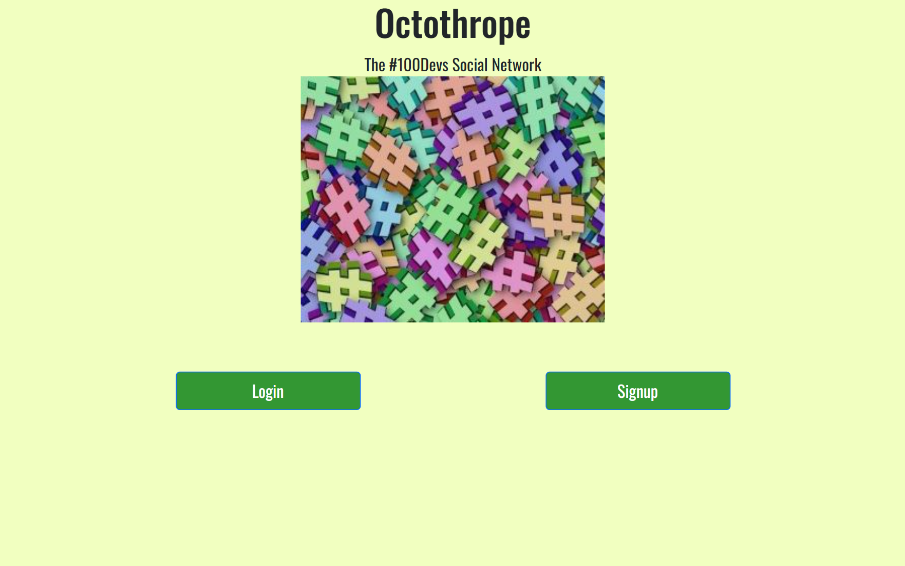

# Binary Boom Social

## Project Description

Binary Boom Social is a fullstack social media app where users can share images of pictures. This was a debugging exercise on a codebase that was created in 2021. I created a feature to add comments to posts and restyled the application. 

### How It's Made:

* HTML & CSS – Structure and styling
* JavaScript – Front-end and back-end functionality
* Node.js – Server-side JavaScript
* Express.js – Routes and handling requests
* MongoDB – Storing user accounts and saved pins
* EJS – Displaying dynamic content
* Passport.js – User authentication

## Installation

1. Clone repo
2. run `npm install`

---

# Things to add

- Create a `.env` file in config folder and add the following as `key = value`
  - PORT = 3000
  - DB_STRING = `your database URI`
  - CLOUD_NAME = `your cloudinary cloud name`
  - API_KEY = `your cloudinary api key`
  - API_SECRET = `your cloudinary api secret`

---

## Usage

1. run `npm run start`
2. Navigate to `localhost:3000

## Screenshots and Demo

### Application Interface

